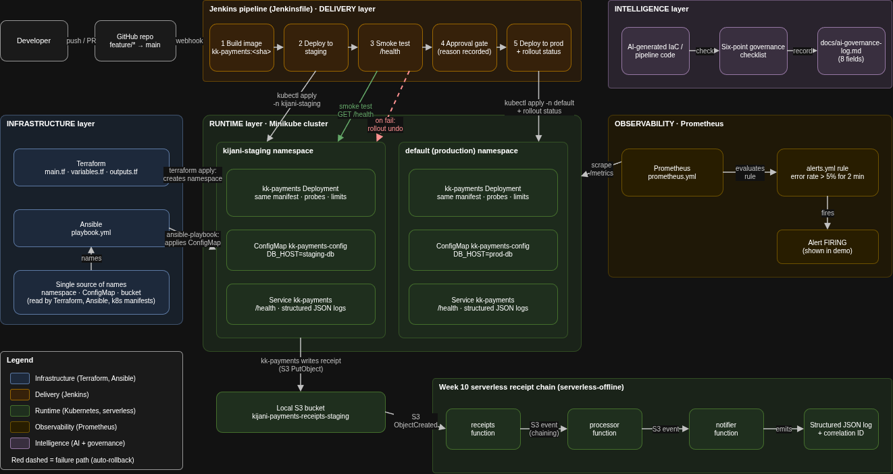

# Capstone Scope Document: Track A

## Problem Statement
kk-payments currently deploys to a single environment (default namespace). There is no staging environment for testing. When a bad image tag is pushed, rollback requires manual intervention. The capstone will provision a kijani-staging namespace using Terraform, configure it with Ansible, update the Jenkins pipeline to deploy to staging first with automated health validation before the production approval gate, and add a Prometheus alert for error rates.

## What I Will Build
- Component 1: A `kijani-staging` namespace provisioned by Terraform and configured via Ansible.
- Component 2: A Jenkins pipeline deploying to staging automatically on merge to `main`.
- Component 3: A `kk-payments` deployment in staging using environment-specific ConfigMaps (e.g., different DB_HOST).
- Component 4: A Prometheus alert rule triggering when error rate > 5% for 2 minutes.
- Component 5: The Week 10 serverless receipt chain integrated with the staging environment.

## What Is Out of Scope
- Item 1: Multi-cloud deployment (Focusing only on the local Minikube cluster for speed).
- Item 2: Automated rollback to production (Focusing only on the staging validation pipeline for this iteration).

## Success Criteria
1. A push to `main` triggers staging deployment automatically.
2. The production gate requires explicit manual approval and shows the staging smoke test result.
3. A deliberately introduced bad image tag triggers an automated rollback in staging before reaching production.

## Architecture Diagram

